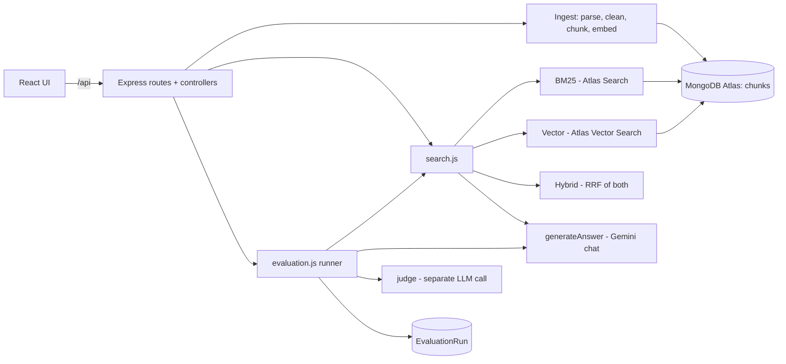

# RAGBench: Multi-Document RAG and Retrieval Evaluation Platform

A MERN app that lets you upload PDF, DOCX and CSV files, ask questions about them with **BM25**, **vector** or **hybrid (RRF)** retrieval, and then **measure which retrieval method works best on your own documents** using Hit Ratio, MRR and latency.

The core RAG logic (chunking, embeddings, BM25, vector search, RRF, citations, metrics) is written directly in plain JavaScript with no LangChain, so every part can be explained in an interview.

## Problem statement
Teams add RAG to their apps but rarely measure whether retrieval actually finds the right passage. RAGBench gives you a small, honest benchmark: you write test questions, tick the passages that really answer them, and the app compares the three retrieval methods on those labels.

## Features
- Upload multiple PDF / DOCX / CSV files; page numbers (PDF), headings (DOCX) and row numbers (CSV) are preserved.
- Pipeline: upload, extract, clean, chunk, embed, store in MongoDB Atlas.
- Three retrieval methods with the same result shape: BM25 (Atlas Search), Vector (Atlas Vector Search), Hybrid (BM25 + vector fused with Reciprocal Rank Fusion).
- LLM answers with validated source citations; "not found" when the evidence does not support an answer.
- Evaluation: create test questions, get passage suggestions, browse every passage, label with checkboxes (you never type chunk IDs).
- Run evaluation: Hit Ratio, MRR, real latency, generated answers, LLM-as-judge verdicts (Correct / Partially Correct / Incorrect), saved run history, Recharts dashboard.

## Technology stack
React + Vite, Tailwind CSS v4, Recharts | Node.js + Express 5 | MongoDB Atlas + Mongoose | pdf-parse, mammoth, csv-parse, Multer | Google Gemini `gemini-embedding-001` (768 dimensions) + a configurable Gemini chat model.

## Project structure
```text
ragbench/
  client/                     React app
    src/pages/                DocumentQA.jsx, Evaluation.jsx
    src/components/           DocumentPanel, SourceCard, PassagePicker, QuestionForm, QuestionTable,
                              RunPanel, ResultsDashboard, PerQuestionResults, ui.jsx
    src/services/api.js       every call to the backend
    src/hooks/useDocuments.js
  server/
    config/                   env.js (settings), db.js (connection + index check), validate.js
    middleware/errors.js      AppError + one JSON error format
    models/                   Document, Chunk, EvaluationQuestion, EvaluationRun
    services/                 fileParser, chunker, embeddings, ingest, bm25Search, vectorSearch,
                              hybridSearch, search, citations, generateAnswer, judge, metrics,
                              questionStatus, evaluation
    controllers/ routes/      thin HTTP layer
    scripts/createIndexes.js  optional: creates the two Atlas indexes from code
    tests/                    node:test unit + API tests
    app.js, server.js
  docs/CODE_WALKTHROUGH.md    stage-by-stage explanation with dry runs
```

## Architecture


## Installation

**Requirements:** Node.js 20 or newer, a free MongoDB Atlas account, a Google Gemini API key (free key from aistudio.google.com/apikey).

```bash
git clone <your repo> ragbench && cd ragbench
npm run install:all                  # installs server and client dependencies
cp server/.env.example server/.env   # then edit server/.env (see below)
```

### Environment variables (`server/.env`)
| Variable | Meaning | Default |
|---|---|---|
| `MONGODB_URI` | Atlas connection string, with database name (e.g. `/ragbench`) | required |
| `GEMINI_API_KEY` | Gemini key (server only) | required |
| `GEMINI_CHAT_MODEL` | Model for answers and judge | `gemini-2.5-flash` (change it if Google retires the name) |
| `EMBEDDING_MODEL` / `EMBEDDING_DIMENSIONS` | Embedding model and its vector size | `gemini-embedding-001` / `768` |
| `CHUNK_SIZE` / `CHUNK_OVERLAP` | Characters per chunk / overlap | `1000` / `150` |
| `MAX_FILE_MB`, `MAX_CSV_ROWS` | Upload limits | `10`, `3000` |
| `SEARCH_INDEX_NAME`, `VECTOR_INDEX_NAME` | Atlas index names | `chunk_text_index`, `chunk_vector_index` |
| `RRF_K`, `HYBRID_CANDIDATES` | RRF constant, candidates per method before fusion | `60`, `20` |

The client needs no `.env`: Vite proxies `/api` to `http://localhost:5000`.

## MongoDB Atlas setup
Steps marked **(manual)** must be done in the Atlas website.

1. **(manual)** Create an account at cloud.mongodb.com, then create a project and a **free M0 cluster**.
2. **(manual)** *Database Access*: add a database user (username + password). *Network Access*: add your current IP address (or `0.0.0.0/0` for a throwaway demo only).
3. **(manual)** *Connect > Drivers*: copy the connection string, put your password in it, add the database name before the `?` (`.../ragbench?retryWrites=...`) and paste into `MONGODB_URI`.
4. Start the server once (`npm run server`) so the app can connect. You will see a warning that the indexes are missing; that is expected.
5. Create the **two search indexes** on collection `ragbench.chunks`. Either:
   - **Automatic:** `npm run create-indexes --prefix server` (uses `collection.createSearchIndex`), or
   - **(manual)** Atlas UI: *Database > Search & Vector Search > Create Search Index*, choose the **JSON editor**, database `ragbench`, collection `chunks`:

   **BM25 index**, type *Atlas Search*, name `chunk_text_index`:
   ```json
   {
     "mappings": {
       "dynamic": false,
       "fields": {
         "text": { "type": "string" },
         "documentId": { "type": "objectId" }
       }
     }
   }
   ```
   **Vector index**, type *Atlas Vector Search*, name `chunk_vector_index`:
   ```json
   {
     "fields": [
       { "type": "vector", "path": "embedding", "numDimensions": 768, "similarity": "cosine" },
       { "type": "filter", "path": "documentId" }
     ]
   }
   ```
   `numDimensions` must equal `EMBEDDING_DIMENSIONS` (768 here). `gemini-embedding-001` can also output 1536 or 3072, but you must then change both the `.env` value and the index. The `filter` entry is what lets the app search only the documents you selected (the "metadata filter").
6. Wait until both indexes show **Active** (1-2 minutes). `GET http://localhost:5000/api/health` shows `"text": "ready"` and `"vector": "ready"` when they work.
7. **Test search:** upload a document, then in the Atlas UI open the BM25 index, click *Search Tester* and search a word from your document. In the app, ask the same question with each of the three methods.

The free M0 tier allows 3 search indexes; RAGBench uses 2.

### Troubleshooting
| Symptom | Cause / fix |
|---|---|
| `MongoServerSelectionError` on start | IP not allowed in Network Access, or wrong password / URI. |
| Yellow "Setup needed" banner, or "index ... is missing" | Create the index with the exact name from `.env`. |
| "index ... is building" | Wait until it is *Active*. |
| Search returns nothing right after upload | Atlas indexes new documents within a few seconds; ask again. |
| `DIMENSION_MISMATCH` | `EMBEDDING_DIMENSIONS` and the vector index `numDimensions` must match the model's real size. |
| 429 / quota errors | Gemini free-tier rate limit; the app retries 3 times, then reports it and does not invent results. Wait a minute, or upload fewer files at once. |
| "Could not list Atlas search indexes" | You are not on Atlas (a local MongoDB has no Atlas Search). |

## Run the app
```bash
npm run server    # terminal 1: API on http://localhost:5000
npm run client    # terminal 2: UI on http://localhost:5173
npm test          # server unit tests (no database or API key needed)
```

## How it works

### Ingestion
`POST /api/documents/upload` runs: validate (extension, magic bytes, size, sanitized name) -> SHA-256 hash (duplicate files are rejected) -> parse -> clean -> chunk -> embed (identical text reuses stored embeddings) -> `Chunk.insertMany`. Failed files leave no chunks behind and show their error.
- **PDF:** one segment per page; scanned PDFs are reported as needing OCR (not in v1).
- **DOCX:** segments follow headings; files without headings get labels like "Paragraphs 1-8". No page numbers are invented.
- **CSV:** one chunk per row, text `column: value | column: value`, empty values skipped. Row numbers match a spreadsheet (header is row 1, first data row is row 2).
- **Chunk id** = `fileHash[:10]_chunkIndex_textHash[:8]`: stable for identical input, different if the text changes.

### Retrieval
| Method | How | Score shown |
|---|---|---|
| BM25 | Atlas `$search` `text` operator on `text`, filtered by `documentId` | BM25 score |
| Vector | Embed question (task type `RETRIEVAL_QUERY`), `$vectorSearch` on `embedding`, filtered by `documentId` | Cosine similarity |
| Hybrid | Take 20 candidates from each, fuse with RRF, cut to top-K | RRF score |

**RRF:** each list gives a chunk `1 / (k + rank)`; scores are summed per chunk. `k = 60` softens the gap between neighbouring ranks. Ranks are used instead of raw scores because BM25 and cosine scores live on different scales.

**BM25 vs vector vs hybrid:** BM25 is strong on exact words (names, codes, numbers) and weak on paraphrases. Vector search finds meaning even with different words but can miss exact identifiers. Hybrid tries to cover both at the cost of two searches. Which wins depends on your data; RAGBench exists to measure it, not assume it.

### Answer generation
Retrieved chunks are put in `<source id="S1" ...>` blocks. The system prompt says the content is untrusted data and must never be treated as instructions, and `</source>` tags inside uploaded text are neutralised. The model returns JSON (`found`, `answer`, `sources`); cited ids that were not retrieved are dropped.

### Evaluation workflow
1. **Create test questions:** type question + expected answer, choose documents, click *Find supporting passages* (hybrid search suggestions) or *Browse all passages* (search every chunk), tick the correct passages, save. Chunk ids are stored automatically.
2. **Run evaluation:** same questions, documents, Top-K, model and prompt for all methods; only retrieval differs. Methods run one after another so timings do not interfere. The expected answer is used only by the judge after generation.
3. **Compare results:** table, three charts, judge counts, per-question answers and retrieved passages.

Questions without passages, or with **stale** labels (a labeled chunk no longer exists because the document was deleted or re-uploaded with different content), still get answers but are excluded from Hit Ratio and MRR and flagged in the UI. Editing the question and choosing passages again fixes it.

### Metrics
- **Hit Ratio** = questions with at least one relevant chunk in top-K / valid labeled questions.
- **MRR** = average of `1 / rank of first relevant chunk` (0 if none in top-K) over valid labeled questions.
- **Latency:** `performance.now()` around retrieval and around retrieval + generation. The judge call is excluded. Vector and hybrid include one embedding call for the question. Averages cover successful calls only.
- The Correct / Partially Correct / Incorrect verdict is an automated LLM assessment and may be wrong.

To record real results: run an evaluation, open *Compare results*, and copy the table and charts into your own notes or screenshots. This README intentionally contains no invented numbers.

## API
| Method | Route | Purpose |
|---|---|---|
| GET | `/api/health` | Server, Gemini key and Atlas index status |
| POST | `/api/documents/upload` | Multipart field `files` (PDF/DOCX/CSV) |
| GET | `/api/documents` | List documents |
| GET | `/api/documents/:id/chunks` | Browse chunks (`?search=&page=&limit=`) |
| DELETE | `/api/documents/:id` | Delete document and its chunks |
| POST | `/api/chat/ask` | `{ question, documentIds, method: bm25\|vector\|hybrid, topK }` |
| POST/GET | `/api/evaluation/questions` | Create / list (with `status`: labeled, no_labels, stale, no_documents) |
| PUT/DELETE | `/api/evaluation/questions/:id` | Edit / delete |
| POST | `/api/evaluation/suggest-chunks` | Suggest supporting passages |
| GET | `/api/evaluation/documents/:id/chunks` | Browse all passages of a document |
| POST | `/api/evaluation/run` | Start a run (returns 202; poll the run) |
| GET | `/api/evaluation/runs`, `/runs/:id` | Run history and details |

Errors always look like `{ "error": { "code": "...", "message": "..." } }`.

## Testing status
**Verified locally (`npm test`, 44 tests, no credentials needed):** chunking and overlap, RRF (hand-calculated example), Hit Ratio, MRR, missing-label handling, citation validation and prompt-injection escaping, real PDF parsing with page numbers, scanned-PDF detection, CSV edge cases, file validation, chunk-id stability, API input validation. The client also builds (`npm run build --prefix client`).

**Not verifiable without your credentials (needs Atlas + Gemini):** actual Atlas `$search` / `$vectorSearch` queries and index creation, real Gemini embeddings and LLM answers, the judge, an end-to-end evaluation run, DOCX parsing against real Word files, and browser behaviour. Use the manual checklist in `docs/CODE_WALKTHROUGH.md` to verify them on your machine.

## Screenshots
Add your own after running an evaluation (`docs/screenshots/`): Document Q&A, passage picker, comparison dashboard.

## Known limitations
- Local single-user demo: **no authentication**, not secure for public multi-user deployment.
- No OCR; scanned PDFs are rejected with a clear message.
- Evaluation quality depends on your labels; passage suggestions come from hybrid search, which can nudge you toward hybrid-friendly passages. Use *Browse all passages* to label independently.
- Small test sets give noisy metrics; chunk size and overlap change results.
- Latency depends on network and API load. Atlas free tier is slow for large Top-K.
- The LLM judge can be wrong. Gemini model names change over time; if you get a 404 model error, change `GEMINI_CHAT_MODEL`. Free-tier rate limits can slow ingestion and evaluation.
- Atlas indexes update asynchronously (seconds after upload).

## Future improvements
Authentication and per-user data, OCR, more file types, background job queue for ingestion, exporting runs as CSV, comparing two runs side by side.
